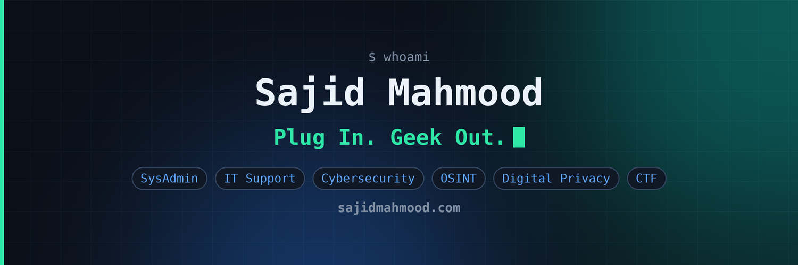

<div align="center">



<a href="https://sajidmahmood.com">
  
</a>

<br/>

[](https://sajidmahmood.com)
[](https://wiki.sajidmahmood.com)
[](https://www.linkedin.com/in/abuturabofficial)

[](https://mastodon.social/@abuturab)
[](https://x.com/abuturabofcl)
[](https://tryhackme.com/p/abuturabofficial)
[](https://www.credly.com/users/abuturabofficial)
[](https://www.coursera.org/learner/abuturabofficial)
[](https://sajidmahmood.com/index.xml)

</div>

---

```console
$ whoami
sajid-mahmood

$ cat about.txt
Self-taught tech enthusiast exploring Windows, Linux, cloud and cybersecurity.
I document and simplify what I learn: system administration, security
practices, privacy, and hardening guides. 🇵🇰

$ cat principles.txt
- Privacy is a right, not a feature.
- Every blog post is written by hand: no AI-generated tutorials.
- Learn in public, share the notes.
```

## 🧰 Focus Areas

| | |
|---|---|
| 🖥️ **SysAdmin & IT Support** | Linux (Arch, Fedora), Windows, KVM/QEMU, troubleshooting guides |
| 🛡️ **Cybersecurity** | Blue-team fundamentals, threat intelligence, CTF challenges |
| 🔎 **OSINT** | Open-source intelligence and tracking malicious actors |
| 🔐 **Digital Privacy** | Password managers, VPNs, digital freedom, hardening |
| ☁️ **DevOps & Cloud** | IBM DevOps / Cloud foundations, Git & GitHub, shell scripting |
| 🐍 **Programming** | Python (Google & University of Michigan tracks), CS theory |

## 🛠️ Tech & Tools


## 📝 Latest from the Blog

<!-- BLOG-POST-LIST:START -->
| Date | Post |
|------|------|
| Jun 04, 2026 | [GNU Coreutils: ls, vdir, realpath](https://sajidmahmood.com/gnu-core-utils-part1/) |
| May 05, 2026 | [Linux Directories Simplified](https://sajidmahmood.com/linux-directories/) |
| May 04, 2026 | [Hugo Theme Stack: Make Avatar Image Respond With Light and Dark Theme](https://sajidmahmood.com/hugo-avatar-change-with-theme/) |
| Apr 30, 2026 | [ThinkPad: Linux Battery Monitoring and Charge Control](https://sajidmahmood.com/thinkpad-battery-monitoring-and-charge-control/) |
| Apr 28, 2026 | [Arch Linux: How to Fix KVM Virtual Machine's Internet Not Working with the Firewall Enabled](https://sajidmahmood.com/fix-virt-manager-internet-issue/) |
| Apr 23, 2026 | [Thunar File Manager: Open any Terminal via Open Terminal Here](https://sajidmahmood.com/thunar-open-terminal/) |
| Apr 08, 2026 | [ImageMagick: A CLI Tool for Quick Image Manipulation](https://sajidmahmood.com/imagemagick-tips-and-tricks/) |
| Feb 23, 2026 | [Fedora Workstation: Things to Do After Installation](https://sajidmahmood.com/fedora-post-installation-guide/) |
<!-- BLOG-POST-LIST:END -->

➡️ [**All posts**](https://sajidmahmood.com/archives/) · 📡 [RSS](https://sajidmahmood.com/index.xml) · 🚩 [CTF feed](https://sajidmahmood.com/categories/ctf/index.xml)

## 🏅 Certifications

> Individual course certificates and my notes for each: [sajidmahmood.com/my-certifications](https://sajidmahmood.com/my-certifications/) · [Notes Wiki](https://wiki.sajidmahmood.com)

<details open>
<summary><b>🛡️ Cybersecurity & Networks</b></summary>

- **IBM Cybersecurity Analyst Professional Certificate** (Coursera): tools & cyberattacks, OS security, compliance, network & database security, pentesting / IR / forensics, threat intelligence, breach-response capstone
- **IT Fundamentals for Cybersecurity Specialization** (IBM)
- **Usable Security** (University of Maryland, College Park), first course of the Cybersecurity Specialization

</details>

<details open>
<summary><b>🖥️ IT & System Administration</b></summary>

- **Google IT Support Professional Certificate**: technical support, networking, operating systems, system administration, IT security
- **IBM IT Support Professional Certificate**: hardware & OS, networking & storage, cybersecurity essentials, cloud, CompTIA ITF+ practice, capstone

</details>

<details open>
<summary><b>☁️ DevOps & Cloud</b></summary>

- **IBM DevOps and Software Engineering Professional Certificate**: DevOps, cloud, Agile & Scrum, software engineering, Linux & shell scripting, Git & GitHub
- **IBM DevOps, Cloud, and Agile Foundations Specialization**
- **IBM IT and Cloud Fundamentals Specialization**

</details>

<details open>
<summary><b>🐍 Computer Science & Programming</b></summary>

- **Python for Everybody Specialization** (University of Michigan)
- **Google IT Automation with Python**: Introduction to Git and GitHub
- **Computer Science Theory** (Khan Academy)

</details>

## 📊 GitHub Stats

<div align="center">


</div>

## 🔐 Get in Touch

- 📧 Email: via the contact page on [sajidmahmood.com/about](https://sajidmahmood.com/about/)
- 🔑 PGP: [public key](https://keys.openpgp.org/vks/v1/by-fingerprint/1561AB4B0D17ECA0A92D2C29B46E542E8DEB33B5) · fingerprint `1561 AB4B 0D17 ECA0 A92D  2C29 B46E 542E 8DEB 33B5`

<div align="center">


*One line of code, one innovation, and one secured step at a time.* 🚀

</div>
